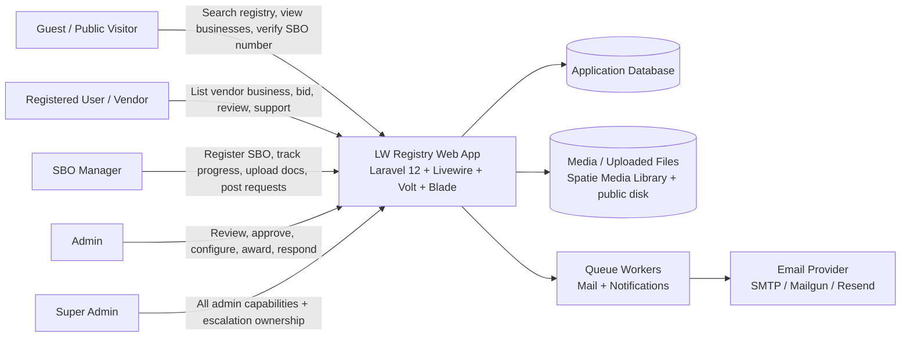
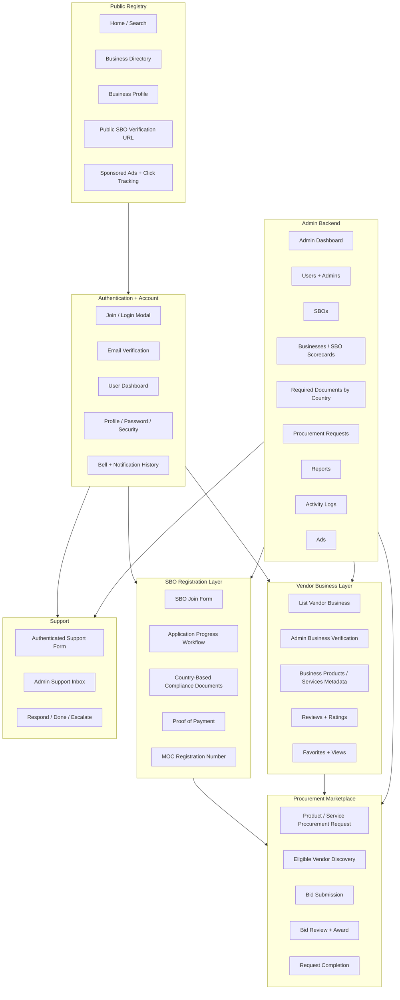
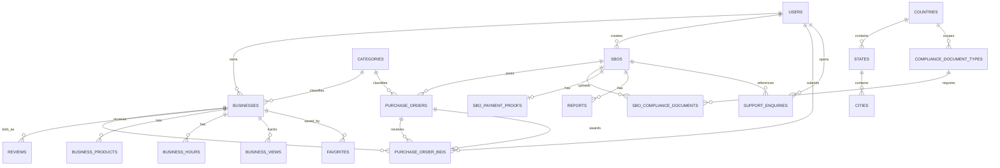
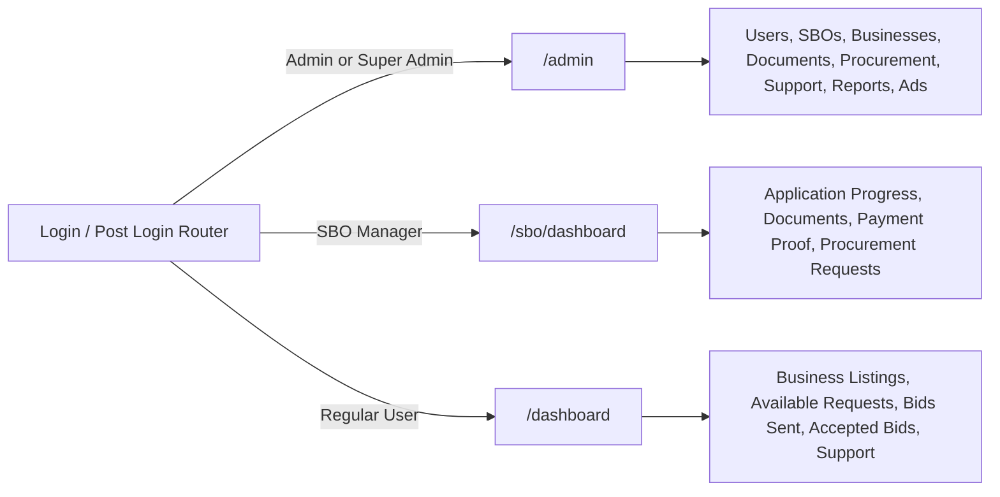
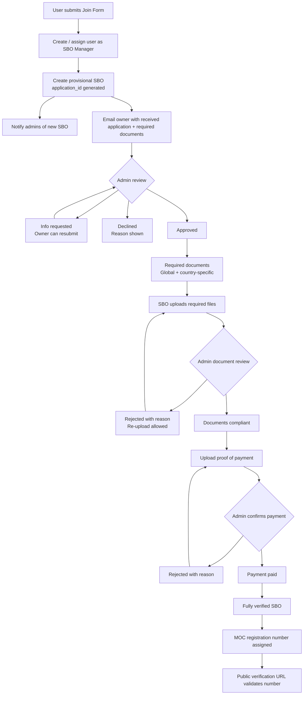
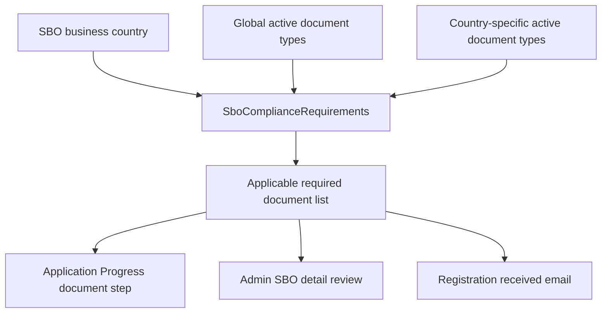
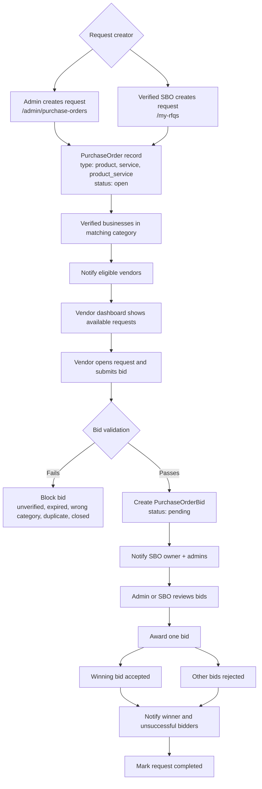
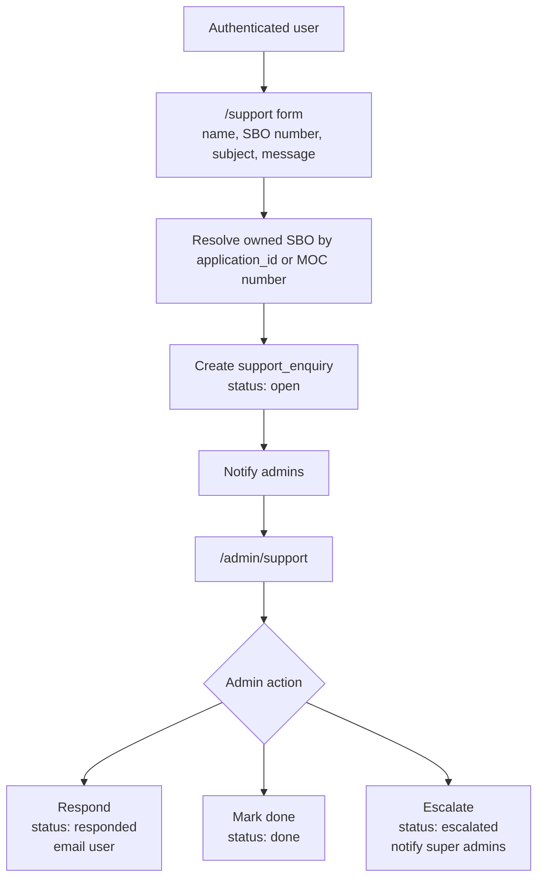
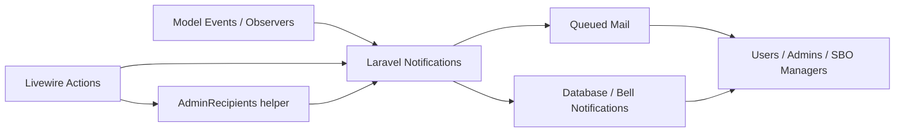
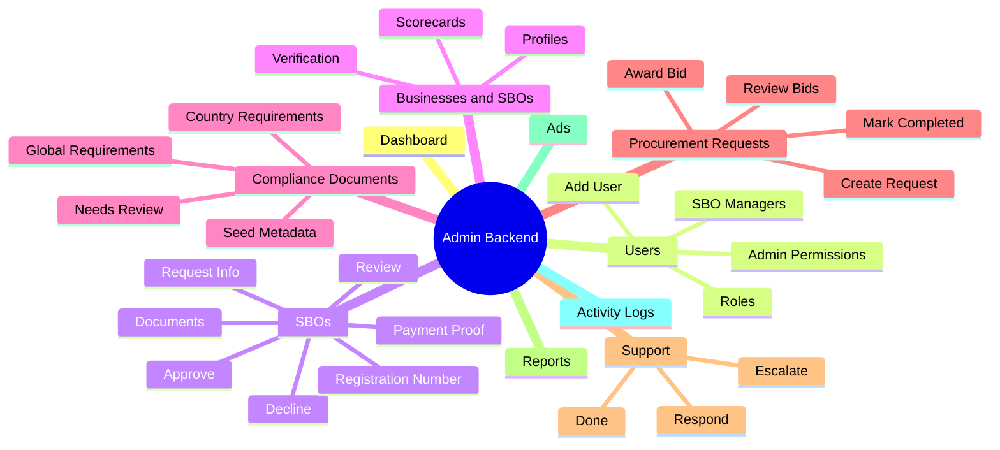

# LW Registry Platform Architecture

This document gives a high-level view of the LW Registry platform, its major features, role-based workflows, and core data relationships.

The diagrams are written in Mermaid so they can render in GitHub, many IDEs, and architecture documentation tools.

## Platform Context

## Application Modules

## Core Data Model

## Role-Based Entry Points

## SBO Registration and Verification Workflow

## Country-Based Compliance Documents

## Procurement Request and Bidding Workflow

## Support Workflow

## Notification and Event Flow

## Admin Capability Areas

## Main Workflow Summary

1. Public users discover verified businesses and validate finalized SBO registration numbers.
2. A prospective SBO submits the join form and becomes an SBO manager with a provisional SBO application.
3. Admins review the SBO, request more information, approve, or decline.
4. Required compliance documents are resolved from global and country-specific document rules.
5. SBO managers upload required documents and proof of payment from the application progress workflow.
6. Admin approval of documents and payment completes verification, assigns an MOC registration number, and enables procurement features.
7. Verified SBOs or admins create product/service procurement requests.
8. Verified vendor businesses in matching categories discover requests, receive notifications, and submit bids.
9. Admins or SBO managers review bids, award one vendor, notify all bidders, and mark the request completed.
10. Authenticated users can submit support enquiries; admins can respond, mark done, or escalate to super admins.

## Technology Stack

- Backend: Laravel 12, PHP 8.4+, Eloquent, middleware, policies, observers, notifications, queues.
- UI: Blade, Livewire, Volt, Vite, Tailwind CSS, Bootstrap-style components.
- Realtime/notifications: Laravel notifications, database bell notifications, queued mail, Reverb/Echo dependencies available.
- Files: Spatie Media Library plus public disk uploads for procurement and bid documents.
- Data: relational database tables for users, businesses, SBOs, compliance documents, payment proofs, procurement requests, bids, support, reports, ads, reviews, favorites, and activity logs.
- Test stack: Pest, Laravel testing helpers, factories, Livewire testing.

## Notes

- Internal model names still use `PurchaseOrder` and `PurchaseOrderBid`, while user-facing screens call them procurement requests and bids.
- `SBO` means Strategic Business Organization; final validation is through the MOC registration number.
- No external MCP lookup was required for this diagram; it is derived from the current repository routes, models, Livewire components, observers, notifications, and migrations.
